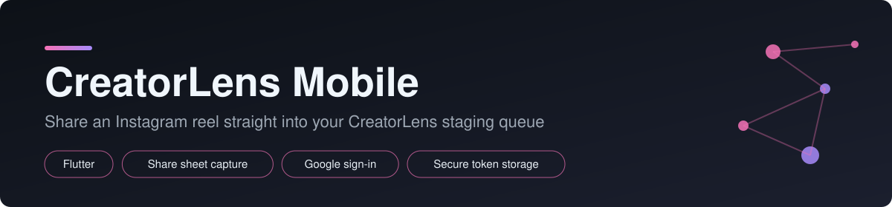
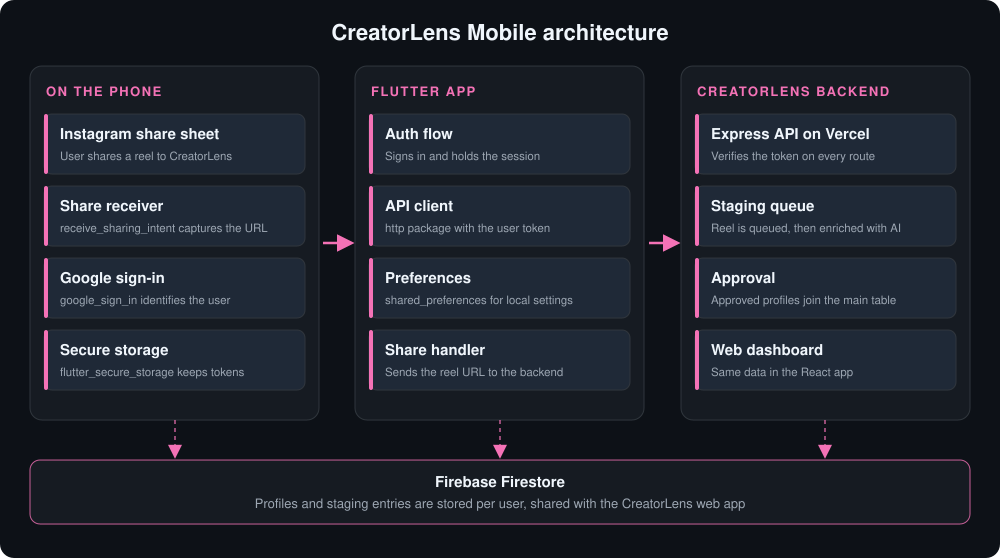

<p align="center">
  
</p>

<h1 align="center">CreatorLens Mobile</h1>

<p align="center">
  <b>Share reels from Instagram straight into your staging queue.</b>
</p>

<p align="center">
  
  
  
</p>

---

## Overview

CreatorLens Mobile is the Flutter companion app for **CreatorLens**. Instead of copying links by hand, a creator taps **Share** on any Instagram reel, picks CreatorLens from the share sheet, and the reel lands in their **staging queue**, ready to be reviewed and used on the CreatorLens platform.

## Architecture

<p align="center">
  
</p>

## Features

- **Share-sheet integration.** Receive reel links shared from Instagram (or any app) using `receive_sharing_intent`, even when the app is closed.
- **Google Sign-In.** One-tap authentication with `google_sign_in`.
- **Secure session storage.** Tokens are kept in the platform keystore through `flutter_secure_storage`.
- **Staging queue.** Shared reels are sent to the CreatorLens backend over HTTPS using `http`.
- **Lightweight preferences.** UI and app settings persisted with `shared_preferences`.
- **Dark-first UI** with a custom launcher icon.

## Tech stack

| Layer | Technology |
|-------|-----------|
| Framework | Flutter (Dart SDK `^3.9.2`) |
| Networking | `http` |
| Share intake | `receive_sharing_intent` |
| Auth | `google_sign_in` |
| Secure storage | `flutter_secure_storage` |
| Local settings | `shared_preferences` |
| Tooling | `flutter_lints`, `flutter_launcher_icons`, `flutter_test` |

## Project structure

```
CreaterLens-App/
├── lib/                  # app source code
├── test/                 # widget and unit tests
├── assets/icon/          # app icon
├── android/              # Android runner
├── ios/                  # iOS runner
├── web/ windows/ linux/ macos/   # other Flutter targets (generated)
├── pubspec.yaml          # package name: pink_data_mobile
└── analysis_options.yaml
```

## Getting started

### Prerequisites

- [Flutter SDK](https://docs.flutter.dev/get-started/install) with Dart `^3.9.2`
- Android Studio or Xcode for emulators and device builds
- A Google Cloud OAuth client for Google Sign-In
- A running CreatorLens backend (the API base URL the app should talk to)

### Install and run

```bash
git clone https://github.com/NartanNaik/CreaterLens-App.git
cd CreaterLens-App

flutter pub get
flutter run
```

### Google Sign-In setup

1. Create an OAuth client in Google Cloud Console (Android and/or iOS).
2. Android: add your SHA-1 fingerprint and place `google-services.json` in `android/app/`.
3. iOS: add the reversed client ID to `ios/Runner/Info.plist` and `GoogleService-Info.plist` to `ios/Runner/`.

### Share-sheet setup

`receive_sharing_intent` needs platform configuration so the app appears in the share sheet:

- **Android:** an `intent-filter` for `ACTION_SEND` (text/plain) in `AndroidManifest.xml`.
- **iOS:** a Share Extension target and a shared App Group.

See the [package documentation](https://pub.dev/packages/receive_sharing_intent) for the exact snippets.

### Generate launcher icons

```bash
dart run flutter_launcher_icons
```

### Run tests

```bash
flutter test
```

### Build a release

```bash
flutter build apk --release        # Android
flutter build ios --release        # iOS (requires macOS)
```

## How it works

1. The user opens a reel on Instagram and taps **Share**.
2. CreatorLens appears in the share sheet and receives the reel link.
3. The app checks the stored session. If there is none, the user signs in with Google.
4. The link is posted to the CreatorLens backend with the user's token.
5. The reel appears in the user's staging queue.

## Roadmap

- Offline queue with retry when the network is unavailable
- Preview thumbnail and caption before sending
- Bulk share and queue management inside the app

## Contributing

Issues and pull requests are welcome. Run `flutter analyze` and `flutter test` before opening a PR.

